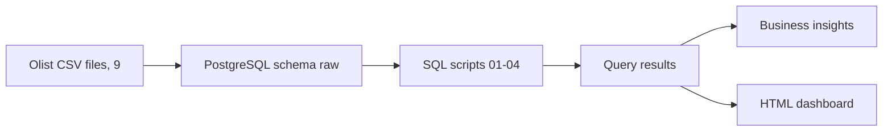

# Architecture

## Data flow

There is no transformation layer. The analysis queries the `raw` schema directly, and cleaning is done inside each query (filtering on order status, removing null dates, de-duplicating by order).

## Tables

| Table | Rows | Grain |
|---|---|---|
| customers | 99,441 | one row per `customer_id` (one per order) |
| orders | 99,441 | one row per order |
| order_items | 112,650 | one row per item in an order |
| order_payments | 103,886 | one row per payment record |
| order_reviews | 99,224 | one row per review |
| products | 32,951 | one row per product |
| sellers | 3,095 | one row per seller |
| geolocation | 1,000,163 | many rows per zip prefix |
| product_category_name_translation | 71 | one row per category |

## Keys and joins

- `orders.customer_id` joins to `customers.customer_id`.
- `customers.customer_unique_id` identifies a real person. `customer_id` changes with every order, so repeat purchases can only be found through `customer_unique_id`.
- `order_items`, `order_payments` and `order_reviews` all join to orders on `order_id`.
- `order_items.seller_id` joins to `sellers`, and `order_items.product_id` to `products`.

## Grain decisions that affect the numbers

| Issue | How it was handled |
|---|---|
| An order can have several payment records | Orders counted with `COUNT(DISTINCT order_id)`; average order value divides total payment value by distinct orders (R$160.99), not by records (R$154.10). |
| An order can have several items and sellers | Delay figures by route are calculated once per order and route before averaging, to avoid counting multi-seller orders twice. |
| An order can have several reviews | Review counts use review rows; the late vs on-time comparison reports both orders and reviews. |
| Late means delivered after the estimated date | Only delivered orders with both dates present are used (96,470). |
| Category-level results | One order with two categories contributes a review to each, so these are category-review records, not unique orders. |

## Definitions

- **Late order:** `order_delivered_customer_date > order_estimated_delivery_date`.
- **Delay days:** the difference between those dates, in days.
- **Repeat customer:** a `customer_unique_id` with more than one order.
- **Interstate order:** seller state differs from customer state.
